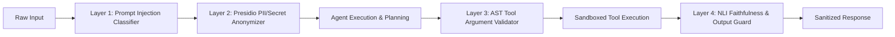
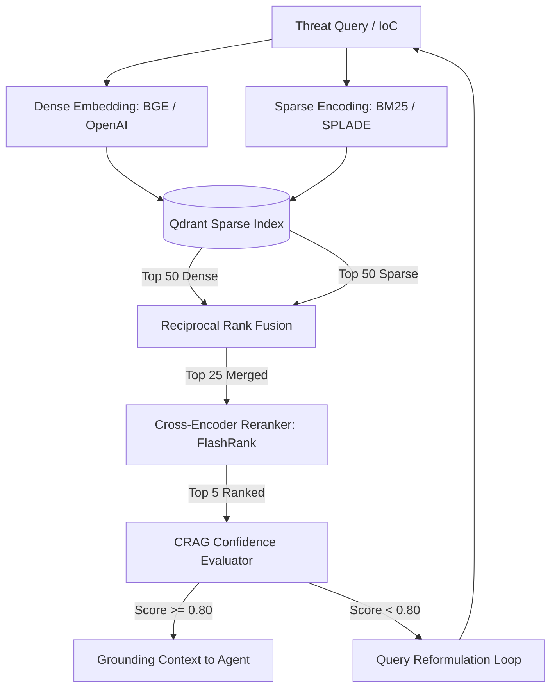

# AutoSOC Technical Architecture Specification

This document defines the complete technical architecture, component specifications, protocols, data flows, and design patterns for the **AutoSOC** platform.

---

## 1. System Architecture Overview

```mermaid
flowchart TD
    subgraph Ingestion & Perimeter Layer
        E1[Raw EDR / Syslog Telemetry Streams] -->|gRPC / Protobuf / mTLS| S1[gRPC Ingestion Service]
        E2[SIEM Webhooks / Analyst Portal] -->|REST / HTTPS / OAuth2| S2[FastAPI Gateway]
    end

    subgraph Security & Perimeter Guardrails
        S1 & S2 --> G1[Input Guardrail: Lakera Prompt Injection Filter]
        G1 --> G2[PII & Secret Sanitizer: Presidio + Reversible Vault]
    end

    subgraph Asynchronous Event Backbone
        G2 -->|Publish soc.alert.raw| MQ[(RabbitMQ Exchange)]
        MQ -->|Queue: alerts.process| W[LangGraph Worker Pool]
        MQ -.->|Dead Letter Queue| DLQ[(Dead-Letter Queue)]
    end

    subgraph State, Memory & Cache Layer
        W <-->|Semantic Vector Caching| R1[(Redis Semantic Cache)]
        W <-->|Distributed Lock 'Redlock'| R2[(Redis Locks)]
        W <-->|LangGraph AsyncCheckpointer| R3[(Redis State Persistence)]
    end

    subgraph LangGraph Multi-Agent Orchestration
        W --> SUP[Supervisor Agent Node]
        SUP <--> TRI[Triage Specialist Node]
        SUP <--> FOR[Forensics Specialist Node]
        SUP <--> INT[Threat Intel & RAG Node]
        SUP <--> CRT[Critic & Reflection Node]
        SUP --> HITL{Human-in-the-Loop Approval Gate}
        HITL -->|Approved| REM[Remediation Execution Node]
        HITL -->|Rejected / Modified| SUP
    end

    subgraph RAG & Knowledge Subsystem
        INT <-->|Dense + Sparse Hybrid Search + RRF| VDB[(Qdrant Vector DB)]
        INT <-->|Cross-Encoder Reranker| RRK[FlashRank / BGE Reranker]
        INT <-->|Corrective RAG / Query Rewriter| CRAG[CRAG Evaluator]
    end

    subgraph Isolated Sandboxed Execution
        FOR & REM -->|AST Validated Tool Call| SBX[Docker Ephemeral Sandbox]
        SBX -.->|Read-Only Root, No Egress, Dropped Caps| OS[Target Log / Memory Artifact]
    end

    subgraph Output Guardrails & Observability
        REM & SUP --> G3[Output Guardrail: NLI Faithfulness & Safety Check]
        G3 --> RES[Incident Report / Action Status]
        W -.->|OTel Spans & Metrics| OTL[Arize Phoenix / OpenTelemetry]
    end
```

---

## 2. Ingress & Dual-Protocol Communication Layer

### 2.1 gRPC Telemetry Service (`protos/telemetry.proto`)
* **Purpose:** Ingest ultra-high-throughput raw event streams from distributed endpoints, EDR sensors, and syslog forwarders with minimal latency and bandwidth overhead.
* **Protocol & Security:** HTTP/2 transport with mutual TLS (mTLS) authentication via X.509 client certificates.
* **Streaming Modes:** Server-streaming and Bidirectional-streaming for live telemetry and threat status back-propagation.
* **Protobuf Schema Definition:**
  ```protobuf
  syntax = "proto3";
  package autosoc.telemetry.v1;

  service TelemetryIngestService {
    rpc StreamAlerts (stream AlertEvent) returns (IngestSummary);
    rpc StreamIncidentUpdates (IncidentSubscription) returns (stream IncidentStatusUpdate);
  }

  message AlertEvent {
    string event_id = 1;
    string source_ip = 2;
    string destination_ip = 3;
    string hostname = 4;
    string event_type = 5;
    int64 timestamp = 6;
    string raw_payload = 7;
    map<string, string> metadata = 8;
  }

  message IngestSummary {
    int32 processed_count = 1;
    int32 rejected_count = 2;
    string batch_id = 3;
  }

  message IncidentSubscription {
    string incident_id = 1;
  }

  message IncidentStatusUpdate {
    string incident_id = 1;
    string current_node = 2;
    string status_message = 3;
    int64 updated_at = 4;
  }
  ```

### 2.2 REST API Gateway (FastAPI)
* **Purpose:** External SIEM webhook integrations (Splunk, Wazuh, PagerDuty), analyst web UI, and administrative management.
* **Security & Auth:** OAuth2 with OpenID Connect (OIDC) and JWT bearer tokens (RS256 signed).
* **Rate Limiting:** Distributed sliding-window token-bucket limiter backed by Redis.
* **Key Endpoints:**
  * `POST /api/v1/incidents/submit`: Synchronous or asynchronous incident ingestion.
  * `GET /api/v1/incidents/{incident_id}`: Retrieve incident state, evidence graph, and audit log.
  * `POST /api/v1/incidents/{incident_id}/approval`: Submit Human-in-the-Loop decision (Approve / Reject / Edit).
  * `GET /api/v1/incidents/{incident_id}/stream`: Server-Sent Events (SSE) for live agent status streaming.

---

## 3. Multi-Tier Guardrails Defense Matrix

Because the agent processes raw log payloads that can be crafted by active adversaries, security cannot rely on prompt instructions. Defense must be multi-layered and deterministic.



### Layer 1: Ingress Prompt Injection & Jailbreak Defense
* **Mechanism:** Dual-stage classifier combining regex heuristic signatures (known jailbreak jailbreaks, instruction overrides) and a specialized transformer classifier (Lakera Guard / DeBERTa-v3 prompt injection detector).
* **Behavior:** If an input string triggers an injection alert (score > 0.85), the raw payload is quarantined, flagged as adversarial telemetry, and wrapped in strict XML tags (`<untrusted_payload_do_not_execute>`) with an alert notification.

### Layer 2: Sensitive Data Redaction & Reversible Vault
* **Tool:** Microsoft Presidio Analyzer + Anonymizer.
* **Coverage:** IP addresses (private vs. public separation), API tokens, JWTs, AWS credentials, SSH private keys, employee PII (SSN, emails, credit cards).
* **Cryptographic Vault:** Redacted tokens are replaced with format-preserving hashes (`<REDACTED_API_KEY_UUID>`). A local, in-memory/Redis encrypted vault retains the reversible mapping so authorized actions can re-hydrate specific values when issuing approved remediation commands.

### Layer 3: AST-Based Tool Execution Guardrail
* **Mechanism:** Python Abstract Syntax Tree (`ast`) analysis on any generated shell commands, forensic script arguments, or API payloads before they touch the sandbox.
* **Policies:**
  * Strict prohibition of root filesystem writes (`/`, `/etc`, `/sys`, `/proc`).
  * Blocking dangerous commands (`rm -rf`, `chmod -R 777`, `mkfs`, network socket creation outside specified subnets).
  * Strict Pydantic v2 schema validation for all structured tool parameters.

### Layer 4: Output Faithfulness & Hallucination Defense
* **Mechanism:** Natural Language Inference (NLI) scoring model (cross-encoder) comparing every assertion in the agent's remediation plan against the retrieved RAG context and verified forensic output.
* **Threshold:** If a statement cites a CVE or remediation step not corroborated by the retrieved documentation with confidence $\ge 0.95$, the assertion is automatically pruned or flagged for human review.

---

## 4. Asynchronous Event Backbone & State Persistence

### 4.1 Message Broker Architecture (RabbitMQ)
* **Exchange:** `soc.direct` (direct) & `soc.events` (topic).
* **Queues:**
  * `alerts.ingest.queue`: Raw incoming events from gRPC and REST.
  * `alerts.triage.queue`: Pre-filtered alerts ready for multi-agent dispatch.
  * `remediation.approval.queue`: Actions awaiting Human-in-the-Loop review.
  * `soc.dlx.queue`: Dead-letter queue for malformed, repeatedly failed, or poisoned messages.
* **Reliability:** Message acknowledgment (`ack`), persistent delivery mode, and consumer prefetch limits to enforce backpressure during high-volume DDoS/malware spikes.

### 4.2 Redis Cluster Services
1. **Semantic Caching:**
   * Uses vector embeddings of alert signatures (computed via fast embedding models).
   * If an incoming alert matches a recent incident with cosine similarity $\ge 0.94$, the system reuses verified analysis and forensic plans, saving LLM cost and reducing MTTR (Mean Time to Respond) from minutes to milliseconds.
2. **LangGraph State Checkpointer:**
   * Implements `AsyncRedisSaver` storing the full execution state graph, step history, and pending interruptions.
   * Enables state resumption across server restarts and long-duration Human-in-the-Loop approval delays.
3. **Distributed Locking (`Redlock`):**
   * Acquires resource-level locks on target hosts (e.g., `lock:host:192.168.1.50`) so multiple concurrent agents do not issue conflicting remediation commands.

---

## 5. LangGraph Multi-Agent Orchestration

### 5.1 Graph State Definition
The core state object carried across nodes:

```python
from typing import TypedDict, List, Dict, Any, Optional

class IncidentState(TypedDict):
    incident_id: str
    raw_event: Dict[str, Any]
    sanitized_event: Dict[str, Any]
    triage_verdict: Optional[str]           # "BENIGN", "SUSPICIOUS", "CRITICAL"
    severity_score: float                   # 0.0 to 10.0
    mitre_tactics: List[str]               # e.g. ["TA0001: Initial Access"]
    forensic_evidence: List[Dict[str, Any]] # Tool execution outputs
    threat_intel_context: List[str]        # Retrieved RAG context
    remediation_plan: Optional[str]         # Proposed actions
    human_approved: bool                    # HITL gate flag
    execution_results: List[str]            # Remediation execution status
    critic_notes: Optional[str]             # Self-correction feedback
    next_step: str                          # Routing decision
```

### 5.2 Agent Roles & Node Topology
* **Supervisor Node:** The orchestrator that evaluates `IncidentState`, plans the investigation, delegates to specialist nodes, and determines when the investigation is complete.
* **Triage Specialist Node:** Normalizes raw events, correlates historical alert frequencies, calculates initial blast radius, and maps to MITRE ATT&CK techniques.
* **Forensics Specialist Node:** Formulates non-destructive forensic queries (log searches, process tree examination, hash calculation) and triggers sandboxed execution.
* **Threat Intel & RAG Node:** Executes hybrid vector search over CVE databases, threat actor profiles, and corporate playbooks.
* **Critic / Reflection Node:** Inspects proposed findings. If the evidence does not conclusively support the triage verdict, it rejects the conclusion and instructs the Supervisor to gather additional forensic artifacts.
* **Human-in-the-Loop (HITL) Checkpoint:** A dedicated LangGraph breakpoint (`interrupt_before=["remediation_executor"]`). The graph yields execution, serializes state to Redis, and posts an interactive review card to the analyst portal.
* **Remediation Executor Node:** Executes approved remediation commands (firewall rules, host isolation, credential revocation) within the sandbox.

---

## 6. Advanced RAG & Retrieval Subsystem



### 6.1 Ingestion & Chunking Pipeline
* **Corpus:** MITRE ATT&CK Enterprise Matrix, NIST Incident Handling Guide (SP 800-61), CISA Known Exploited Vulnerabilities (KEV), and organization-specific incident playbooks.
* **Chunking:** Semantic hierarchical chunking preserving header hierarchy, table structures, and code blocks with 20% token overlap and parent-document metadata linkage.

### 6.2 Hybrid Retrieval with Reciprocal Rank Fusion (RRF)
* **Vector Store:** Qdrant with dual vectors:
  * Dense vector index (cosine distance, 1536/768 dimensions).
  * Sparse BM25 vector index for exact keyword matching (critical for CVE IDs, registry keys, file hashes, and IP addresses).
* **RRF Formula:**
  $$RRF\_Score(d) = \sum_{m \in \{dense, sparse\}} \frac{1}{k + rank_m(d)} \quad (k = 60)$$

### 6.3 Cross-Encoder Re-Ranking & Corrective RAG (CRAG)
* **Reranker:** FlashRank / `bge-reranker-large` compresses the top 25 candidates down to the 5 most semantically relevant chunks.
* **Self-RAG Evaluator:** If the top chunk relevance score is below 0.80, the CRAG module initiates an automated query reformulation node to expand acronyms or search alternative IoC aliases.

---

## 7. Sandboxed Forensic Tool Runner

To guarantee that forensic tools or agent-generated scripts cannot compromise the host system:
* **Runtime:** Ephemeral Docker containers (or gVisor runsc runtime).
* **Isolation Constraints:**
  * Root filesystem mounted strictly as **read-only** (`--read-only`).
  * Drop all Linux capabilities (`--cap-drop=ALL`).
  * Disallow privilege escalation (`--security-opt=no-new-privileges:true`).
  * Memory ceiling (512MB) and CPU ceiling (0.5 vCPU).
  * Zero internet connectivity (`--network=none`), except when querying an isolated mock intranet network.
  * Target log files and memory dumps are mounted as read-only volumes.

---

## 8. Observability, Telemetry & Continuous Evals

### 8.1 Distributed Tracing (OpenTelemetry + Phoenix)
* Every incident assigns an OpenTelemetry trace context propagated across gRPC metadata, RabbitMQ message headers, and LangGraph node executions.
* Integration with **Arize Phoenix** (self-hosted) to capture token usage, prompt versions, step latency waterfalls, and tool call traces.

### 8.2 Automated Continuous Evaluation Harness (DeepEval)
* Runs as a pre-commit or CI/CD test suite across standard benchmark incident scenarios:
  * **Faithfulness Metric:** Measures whether the remediation plan contains any claims not present in the RAG context.
  * **Answer Relevancy Metric:** Evaluates the quality and conciseness of the triage report.
  * **Context Precision & Recall:** Validates that the hybrid RAG retriever fetched the exact necessary playbooks.
  * **Adversarial Robustness Metric:** Injects prompt injection payloads into test logs to assert 100% quarantine rate.

---

## 9. Comprehensive Monorepo Directory Layout

```text
auto-soc/
├── README.md
├── ARCHITECTURE.md
├── CHECKLIST.md
├── docker-compose.yml
├── pyproject.toml
├── .env.example
├── protos/
│   ├── telemetry.proto
│   └── incident.proto
├── scripts/
│   ├── generate_protos.sh
│   ├── seed_threat_intel.py
│   └── simulate_attack.py
├── src/
│   ├── __init__.py
│   ├── config.py
│   ├── api/
│   │   ├── __init__.py
│   │   ├── rest/
│   │   │   ├── app.py
│   │   │   ├── routes/
│   │   │   └── middleware/
│   │   └── grpc/
│   │       ├── server.py
│   │       └── telemetry_servicer.py
│   ├── guardrails/
│   │   ├── __init__.py
│   │   ├── injection_filter.py
│   │   ├── presidio_sanitizer.py
│   │   ├── ast_tool_validator.py
│   │   └── nli_faithfulness.py
│   ├── queue/
│   │   ├── __init__.py
│   │   ├── rabbitmq_client.py
│   │   ├── publisher.py
│   │   └── consumers/
│   ├── cache/
│   │   ├── __init__.py
│   │   ├── redis_client.py
│   │   ├── semantic_cache.py
│   │   └── distributed_lock.py
│   ├── rag/
│   │   ├── __init__.py
│   │   ├── qdrant_client.py
│   │   ├── ingestion.py
│   │   ├── hybrid_search.py
│   │   ├── reranker.py
│   │   └── crag_evaluator.py
│   ├── agents/
│   │   ├── __init__.py
│   │   ├── state.py
│   │   ├── supervisor.py
│   │   ├── nodes/
│   │   │   ├── triage_node.py
│   │   │   ├── forensics_node.py
│   │   │   ├── threat_intel_node.py
│   │   │   ├── remediation_node.py
│   │   │   └── critic_node.py
│   │   └── graph.py
│   ├── sandbox/
│   │   ├── __init__.py
│   │   ├── docker_runner.py
│   │   └── tools/
│   └── telemetry/
│       ├── __init__.py
│       ├── otel_config.py
│       └── phoenix_tracer.py
└── tests/
    ├── unit/
    ├── integration/
    └── evals/
        ├── datasets/
        └── test_agent_evals.py
```
